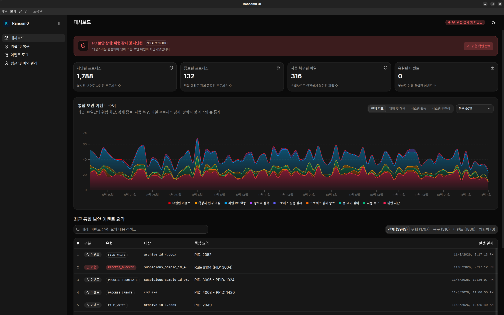
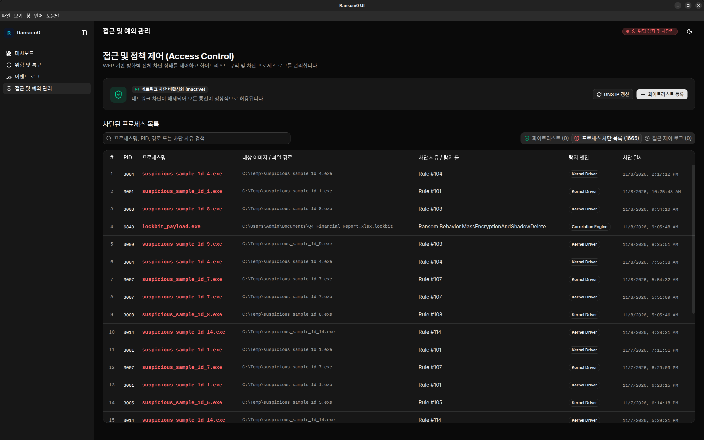

# Ransom0 UI

안티 랜섬웨어인 **Ransom0** 전용 UI 앱입니다.

## Overview

## Components

이 앱은 Windows, Linux, macOS 환경을 모두 지원합니다.
단, 현재 연동되는 엔진 및 방화벽 서비스는 Windows 전용입니다.

- [커널](https://github.com/ransomguard/kernel)
- [상관분석/복구](https://github.com/ransomguard/restore)
- [방화벽](https://github.com/ransomguard/firewall-manager)

## Usage

앱을 실행하면 시스템 트레이에 상주하며,
각 서비스와 Named Pipe(Windows) 또는 Socket(Linux/macOS)으로 통신합니다.

| Target          | Windows                     | Linux / macOS                | Direction    |
|-----------------|-----------------------------|------------------------------|--------------|
| Security Engine | `\\.\pipe\Ransom0_UI`       | `/tmp/Ransom0_UI.sock`       | Engine -> UI |
| Firewall Daemon | `\\.\pipe\Ransom0_Firewall` | `/tmp/Ransom0_Firewall.sock` | UI -> Daemon |

### Monitoring

- UI 앱이 IPC 서버를 열고 커널 및 상관분석/복구 엔진이 전송하는 개행(`\n`) 구분 JSON 스트림을 수신합니다.
- 수신된 로그는 로컬 SQLite DB에 저장되며, 위협 탐지 및 차단 이벤트 발생 시 시스템 트레이 알림이 표시됩니다.
- 메시지 규격은 [ipc-receiver](./electron/services/ipc-receiver/README.md)에서 확인할 수 있습니다.

### Firewall Whitelist

- 실행 중인 방화벽 데몬에 연결하여 차단 활성화 여부를 확인합니다.
- `접근 및 예외 관리` 메뉴에서 화이트리스트 대상(IP, CIDR, 도메인, URL, 포트)을 추가/삭제하거나 도메인 DNS IP를 갱신할 수 있습니다.

## Contributing

[CONTRIBUTING.md](./CONTRIBUTING.md)
